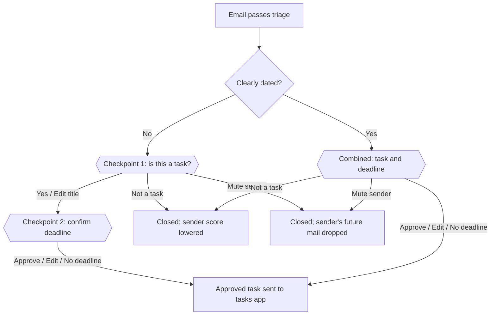

# Approval Flow

An email becomes a task only after your approval on Discord: two approvals normally, or one combined approval for a clearly dated email. The email service runs every checkpoint itself and sends the tasks app only a fully approved task. Nothing is ever created on a timeout.

The double-bordered boxes are your decisions; everything else is automatic. This diagram was rebuilt from the original doc's text, because its embedded diagram did not survive the export.

## Checkpoint 1: is this a task?

The Discord message is a card showing the sender, subject, a short local summary and the proposed title, each inside a code block so nothing in the email can format text, make a link or mention anyone, and an Open email button. For Gmail and Outlook the link opens the exact email; for Yahoo it opens your Yahoo inbox. It never includes the body.

| Button | Result |
| --- | --- |
| Show full text | Shows the full email in a private reply (see below); does not answer the checkpoint |
| Yes | Moves on to checkpoint 2 with the extracted title |
| Edit title | You change the title, then it moves on to checkpoint 2 |
| Not a task | Item is closed and the sender's score drops |
| Mute sender | Item is closed and future mail from the sender is dropped by the rules |
| Trust sender | Adds the sender to your trusted list (see below); does not answer the checkpoint |

Once you answer, the card updates in place to show your answer, and only Show full text and Open email remain. Only your first answer counts.

## Trusted senders

The trusted list starts empty and grows as you use the service.

- **Adding.** Tap Trust sender on any notification, or use a Discord command such as `/trust name@example.com` to add someone before they've emailed.
- **Removing.** `/untrust name@example.com`. `/trusted` lists everyone on the list.
- **Muted senders.** Mute sender is a button; `/unmute name@example.com` lets a sender's mail through again, and `/muted` lists them.
- **Setup.** `mailroom discord-commands` registers the commands in your server once; they are hidden from members without admin rights.
- **Effect.** A trusted sender's mail is never dropped by the bulk-mail rules and always reaches the extractor. It still needs your approval like any other email; auto-creating tasks for trusted senders is [deferred](roadmap.md#deferred-items).
- **Matching.** Trust applies to an exact email address, not a whole domain, so a look-alike address isn't trusted by accident.
- **Verified senders only.** The email must also pass the provider's authentication checks, so a forged "From" address doesn't count as trusted (see [Triage](triage.md#pipeline)).

## Who can answer

Only you. Every button press and command is checked against your Discord user ID and ignored if it comes from anyone else.

## Checkpoint 2: confirm the deadline

The message shows the proposed title, the deadline and the evidence quote it came from.

| Button | Result |
| --- | --- |
| Show full text | Same as at checkpoint 1 |
| Approve | The approved task is sent to the tasks app with the proposed deadline |
| Edit | You change the title or deadline first, then it is sent |
| No deadline | The approved task is sent without a deadline |

The email service runs this checkpoint itself, the same as checkpoint 1. The tasks app doesn't ask you again; it receives a task you have already approved.

## Combined approval for clearly dated emails

When an email is clearly dated, the two checkpoints are merged into one Discord message showing the sender, subject, summary, link, proposed title, deadline and evidence quote.

An email counts as clearly dated only when code confirms all of these; the model does not decide:

- the email is not flagged as suspected spam or phishing
- the extractor returned an explicit deadline, not one inferred from vague wording
- the evidence quote appears word for word in the email
- the deadline resolves to a single date (and time, if given)
- confidence is at or above the threshold set in code

| Button | Result |
| --- | --- |
| Show full text | Same as at checkpoint 1 |
| Approve | Task is created with the title and deadline shown |
| Edit | You change the title or deadline first |
| No deadline | Task is created without a deadline |
| Not a task | Item is closed and the sender's score drops |
| Mute sender | Item is closed and future mail from the sender is dropped by the rules |
| Trust sender | Same as at checkpoint 1 |

## Reading the full email

Tapping Show full text sends the email's text as a Discord ephemeral reply: only you can see it, and it is not saved in the channel history. It disappears when you dismiss it or restart the app.

- The text is plain text, shown in a code block so links in the email are not clickable from Discord. This keeps a phishing link from being one tap away.
- Discord limits message length, so a long email is cut off with a note saying so. Use the link to read the rest (for Yahoo, find the email in your inbox).
- The text is only sent when you tap the button, and it still passes through Discord's servers when it is.
- After 24 hours the email text has been deleted (see [retention](ingestion.md#retention)), so Show full text says it has expired and points you to the link.

## Busy hours: batching

There is no cap on notifications, so no email is held back or dropped. When more than 20 notifications have gone out in the past hour (a starting value you can change), new ones are batched instead of sent one by one:

- Every 15 minutes, the waiting emails go out as one digest message, so you get one ping instead of many.
- The digest lists the emails from most to least important, and each email's full notification, with all its buttons, is posted in a thread under the digest in the same order.
- Batching stops once the past hour drops back below the threshold.

Importance is ranked by code from the extractor's fields, not by the model:

1. Trusted senders before others (trust needs a verified sender, so it can't be faked)
2. Suspected spam or phishing last
3. Urgent before not urgent
4. Soonest deadline first; emails with a deadline before those without
5. Higher confidence before lower
6. Newest first, to break ties

An email the model couldn't read ranks as if nothing is known about it: not urgent, no deadline, lowest confidence.

Trust comes before urgency because urgency is judged from the email's own wording, which a phishing email can fake.

## Unanswered items

Built in stage 6, with digests.

If you do not answer within 30 minutes, the service sends one follow-up, then lists the item as pending. For a digest, the follow-up lists only the emails still unanswered, in the same order. An item stays pending until you answer; nothing is created automatically.
