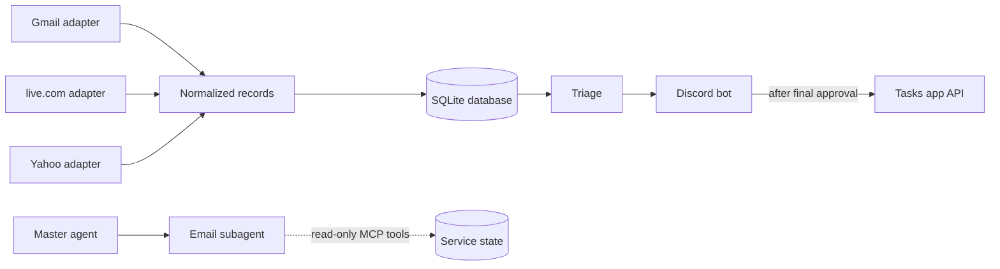

# Architecture

The email service is a separate process from the tasks app. It has its own credentials, handles untrusted input and runs its own polling loop.

## Components

| Component | Job |
| --- | --- |
| Provider adapters | Poll one provider each and turn its messages into normalized records. See [Ingestion](ingestion.md). |
| Database | One local SQLite file holding all service state, including dedup keys. See [Database](#database). |
| Triage | Rules, then the local extractor, then validation and the notify decision. See [Triage](triage.md). |
| Discord bot | Posts the approval prompts and handles the buttons. See [Approval flow](approval-flow.md). |
| Tasks app client | Sends fully approved tasks to the tasks app. See [Interfaces](interfaces.md). |
| MCP server | Read-only tools for the email subagent. See [Interfaces](interfaces.md). |
| Audit log | Records every state change, what triggered it and the original message ID. |

## Package

The service is the Python package `mailroom` (`src/mailroom/`), with the command `mailroom`. Every module reads the current time through `mailroom.clock`, makes ids through `mailroom.ids`, reads settings through `mailroom.config.get_settings()` (variables prefixed `MAILROOM_`), and reads secrets through `mailroom.keychain.get_secret(name)`, which reads the login Keychain item with service `mailroom` and the secret's name as its account. The only writer is the login command, through `mailroom.keychain.set_secret(name, value)`. The data folder is `MAILROOM_DATA_DIR`, by default `~/Library/Application Support/mailroom`, kept at mode `0o700` and outside anything iCloud syncs.

## Normalized record

Every adapter produces the same record shape, so triage never knows which provider a message came from. Each adapter fetches the raw RFC 822 message and supplies the provider, message ID, thread ID, received time and link; one shared parser (`mailroom.mime`) reads the rest from the raw message. The parser never raises and never drops a message: what it cannot read is left empty. Every string from the email is cleaned to plain text and cut to a limit. The record is `mailroom.record.Record`.

| Field | Notes |
| --- | --- |
| provider | `gmail`, `outlook` or `yahoo` |
| message ID | Stable per provider; see [Ingestion](ingestion.md) for how Yahoo's is derived |
| thread ID | Native for Gmail and Graph; derived from headers for Yahoo |
| sender | Lower-case address, or empty if missing or malformed; at most 254 characters |
| sender name | Display name, at most 100 characters; can look like an address, so never trusted |
| subject | One line, at most 200 characters |
| received time | When the provider received it |
| sent time | From the `Date` header, in UTC, or empty; used later to resolve relative deadlines |
| body text | Plain text (HTML converted, link addresses kept as text), at most 100,000 characters. Sent to the local model, and to Discord only as a private reply when you tap Show full text; never to a hosted model |
| link | Link to the exact message for Gmail and Outlook; link to the Yahoo inbox for Yahoo |
| list-unsubscribe | Whether the email has a `List-Unsubscribe` header; lowers the score in triage |
| authentication results | The `Authentication-Results` headers, read by the sender check |

## Database

All service state lives in one SQLite database (`mailroom.sqlite3` in the data folder): a single local file, with no separate server to run or secure. It's backed up with the rest of the Mac.

- **Private.** The file has mode `0o600`, inside the `0o700` data folder.
- **Cleared text leaves the file.** `secure_delete` is on, so cleared text is overwritten rather than left in free pages, and the default rollback journal is kept, so no write-ahead log holds old text.
- **Schema.** The schema is numbered migrations (`mailroom.schema`), tracked in `PRAGMA user_version`; each table arrives with the phase that needs it.

| Table | Holds | Kept |
| --- | --- | --- |
| messages | Normalized records, including body text | Body text and authentication results cleared 24 hours after fetch; the row stays as a dedup key |
| triage | Each email's verdict: dropped, extracted or rejected (with the field name), the sender flags, whether to notify, and the extractor output (summary, title, deadline, quote, spam reason) | Extractor output cleared with the email's text, 24 hours after fetch; the verdict stays |
| threads | Thread ID to task ID mapping | Long term; no email text |
| posts | Each notified email's item id, when it was queued, and its Discord message ID once posted | Long term; no email text |
| answers | Your first answer to each posted email (yes, edit, not a task, mute), with the approved title for yes and edit | Long term; the title is kept like a pending item's task title |
| senders | Trusted and muted lists, sender scores | Long term |
| sync_state | Each account's sync bookmark and last successful poll | Long term |
| audit_log | Every state change, what triggered it and the message ID | Long term; no email text |

**No vector search in v1.** Every lookup the service needs is exact: by message ID, thread ID or sender address. Vector embeddings would only help with fuzzy matching, such as spotting that a new email is about the same task as an older one in a different thread. Embeddings are derived from email text and can leak some of it, so they'd also have to be deleted after 24 hours, which removes most of their value. Fuzzy matching is listed as [deferred](roadmap.md#deferred-items).

## Runtime

The service and its local model run on the home Mac Studio (128 or 256 GB of memory), which has room for a 27B+ model. It needs no public endpoint, because new mail is found by polling.

### Keeping it running

- **launchd.** The service runs as a launchd LaunchAgent, the macOS built-in way to run background services. With `RunAtLoad` it starts when you log in, and with `KeepAlive` launchd restarts it within seconds if it crashes.
- **Why a LaunchAgent.** A LaunchAgent runs as your user, so it can read your login Keychain, where the tokens and app password are stored. A system-wide LaunchDaemon starts before login but can't easily read that Keychain. The trade-off is that the Mac must log in to your account after a reboot, so turn on automatic login or log in after updates.
- **Detecting failures launchd can't fix.** If the email subagent can't reach the service, for example because it keeps crashing on startup, it tells you on Discord. The subagent reports the problem; it doesn't restart anything.
- **Stale polling.** `get_triage_stats` shows the last poll time for each account, so a stuck account is visible even while the service is up.
- **No sleep.** The Mac Studio is set never to sleep, since polling stops while it sleeps.
- **Discord outages.** If a Discord message fails to send, it's queued in the database and retried until it goes through. A notification is never lost.
- **Memory.** Before building, check that the extractor runs at a usable speed while the Mac's other services and agents are busy, especially on a 128 GB machine.

## Agents

A master agent coordinates one subagent per app. Email work goes to a dedicated email subagent, which is the only agent that calls this service's MCP tools. Summaries are written by the local model from untrusted email text, so a hostile email could try to plant instructions in one. Keeping them inside the email subagent stops that from reaching agents working on other apps. The email subagent passes the master agent only what it needs, such as an approved task title and time.

A task title is still derived from an email, even after you approve it. It is plain text of at most 100 characters, and the master agent treats it as data to store or display, never as instructions to follow.
